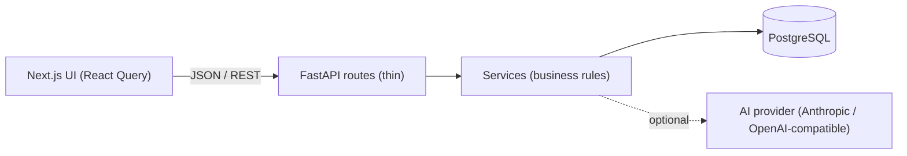

# Architecture

LeadFlow is a modular monolith: one FastAPI service, one PostgreSQL database and one Next.js frontend.

## Backend layout

| Path | Responsibility |
| --- | --- |
| `app/api/routes` | HTTP only: parse input, call a service, return a typed response |
| `app/services` | Business rules and transactions (`leads`, `discussions`, `followups`, `conversation_brief`) |
| `app/schemas` | Pydantic request and response models, input trimming and validation |
| `app/models` | SQLAlchemy 2 models (`Lead`, `Discussion`, `FollowUp`) |
| `app/core` | Settings, the error envelope, enums, time rules |
| `alembic/` | Migrations (the schema is never created implicitly at startup) |
| `scripts/seed.py` | Idempotent demo data |

## Data model

- `leads(id, name, company, phone, status, created_at, updated_at)`. Status is limited to the six values by a CHECK constraint.
- `discussions(id, lead_id, note, created_at)`. A note must not be blank (CHECK constraint).
- `follow_ups(id, lead_id, discussion_id UNIQUE NULL, scheduled_at, status, created_at, updated_at, completed_at)`. Status is `pending`, `completed` or `cancelled`.

A lead can have many follow-ups, so history is never lost. A discussion creates at most one follow-up, which lets the timeline explain why a reminder exists.

`next_follow_up_at` is **computed**, not stored: it is the earliest `pending` follow-up of the lead. There is one source of truth and nothing to keep in sync. The lead list is one SQL statement (no N+1) that joins the latest discussion, the discussion count, the next pending follow-up and the pending/overdue counts.

## Time rules (one place: `app/core/timeutils.py`)

- Everything is stored and exchanged as timezone-aware UTC.
- "What day is it?" is always answered in `APP_TIMEZONE` (default `Asia/Kolkata`).
- A pending follow-up is **overdue** when its instant is earlier than now.
- It is **due today** when it is not overdue and falls on today's calendar date in `APP_TIMEZONE`. Later dates are **upcoming**.
- A follow-up time sent without an offset (`2026-10-16T14:00`) is read in `APP_TIMEZONE`. The browser never converts time zones; the UI displays everything in the timezone the API reports at `GET /api/config`.
- Follow-ups must be scheduled for the future (60 seconds of grace for minute-granular pickers).
- Clients never classify reminders themselves: the API returns `state` (`overdue`, `today`, `upcoming`) for each pending one.

## Lead list ordering

1. Leads whose next pending follow-up is overdue, oldest first.
2. Leads whose next pending follow-up is due today, earliest first.
3. Everyone else, most recent activity first (last discussion, else creation time).

Ties break on `id` so pagination is deterministic. Completed and cancelled follow-ups never affect ordering or the queue. The follow-up queue above the list shows individual reminders (so a lead with two reminders shows two rows), while the list shows each lead exactly once.

## Transactions

`POST /api/leads/{id}/discussions` writes the discussion, its optional follow-up and any follow-ups the user chose to complete in one transaction. A failure anywhere rolls everything back (covered by a test that forces the follow-up insert to fail).

Overdue follow-ups are never closed implicitly. Closing one is always an explicit user action: the *Done* button, or the checkbox in the discussion form.

## Frontend

Next.js App Router, TypeScript strict, Tailwind CSS 4 with design tokens in `app/globals.css`, Radix Dialog for focus-trapped accessible dialogs, TanStack Query for server state, react-hook-form + zod for forms and Lucide icons.

- `components/workspace.tsx` owns page state (search, status filter, selected lead).
- `components/leads`, `followups`, `timeline`, `dialogs` hold feature components. `components/ui` has the small design-system primitives.
- `hooks/use-app-data.ts` holds every query and mutation. `lib/api.ts` is the only code that calls `fetch`.
- The backend is the source of truth. After a mutation the cache is patched with the API response (so the list updates immediately) and then refetched. Lists also refresh every 60 seconds and on window focus. Stale search responses cannot overwrite newer ones because queries are keyed by their parameters.
- A double click on Save is blocked by a synchronous guard and the pending button state.

## AI Conversation Brief

`POST /api/leads/{id}/conversation-brief` uses a small provider interface:

| `AI_PROVIDER` | Behaviour |
| --- | --- |
| `demo` (default) | Deterministic, rule-based extraction from the recorded notes. Labelled "Demo mode" in the response and the UI. No model is called. |
| `anthropic` / `openai` | Real model call over HTTP with the notes as data. Output is parsed and validated. |
| `none`, or a provider without a key | `503 AI_UNAVAILABLE`. The rest of the app is unaffected. |

If a real model call fails or returns unusable output the API returns `502`. It never falls back to an invented or demo brief. The system prompt forbids inventing facts and giving financial advice, and tells the model to treat notes as data, not instructions. The UI separates recorded facts ("From your notes") from suggestions ("Suggestion"). LeadFlow never sends messages.
